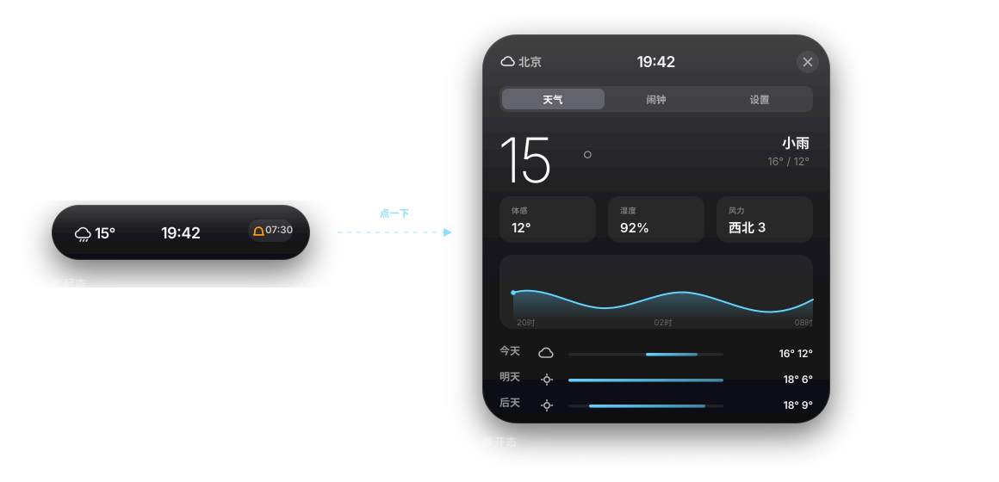

# 灵动岛 · LingDao

Windows 桌面上的悬浮胶囊小工具，仿 iPhone 灵动岛。收起时是屏幕顶部一条安静的药丸，点一下展开成一张刚好包住内容的玻璃卡片。

- **天气**：和风天气实时 + 24 小时曲线 + 三日预报
- **闹钟**：多组闹钟、重复规则、快捷加钟、到点响铃 + 系统通知
- **跟随系统**：自动切换深色 / 浅色



> 上图是矢量示意图（SVG 能直接进仓库）。真实渲染截图见项目根目录的 `.preview/desk-*.jpg`，
> 那个目录不进版本库 —— 想放进 README，拖到 GitHub 的网页编辑器里上传即可。

## 运行

需要 Node.js 18+（推荐 20/22）。

```bash
npm install
npm start
```

首次启动会出现在屏幕顶部居中位置，同时常驻系统托盘。

## 打包成 exe

```bash
npm run build:win
```

产物在 `dist/`：`LingDao Setup x.y.z.exe`（安装版）。打包机需要联网下载 Electron 二进制，国内建议先设置镜像：

```bash
set ELECTRON_MIRROR=https://npmmirror.com/mirrors/electron/
set ELECTRON_BUILDER_BINARIES_MIRROR=https://npmmirror.com/mirrors/electron-builder-binaries/
npm run build:win
```

## 操作

| 动作 | 效果 |
| --- | --- |
| 点胶囊 | 展开 |
| 拖胶囊 | 移动位置（会自动记住） |
| 点右上角 ✕ / Esc / 点桌面 | 收起 |
| 托盘单击 | 显示 / 隐藏 |
| 托盘右键 | 刷新天气、主题、开机自启、退出 |

## 自定义

- **换城市**：展开 → 天气页 → 「切换城市」
- **改默认城市**：`src/main/config.js` 的 `DEFAULT_CITY`
- **换 API Key**：`src/main/config.js` 的 `QWEATHER`
- **改尺寸**：`src/main/config.js` 的 `WINDOW` 与 `src/renderer/scripts/island.js` 的 `SIZE`，两处必须同步
- **改配色 / 圆角 / 字号**：`src/renderer/styles/tokens.css` 一个文件搞定
- **换图标**：改 `tools/make-icons.py` 里的配色和波形，跑一次就会重画 `build/icon.ico`；
  托盘图标是内联在 `src/main/icon.js` 里的 data URL，加 `--base64` 参数会打印替换用的新字符串

> 仓库里不存二进制文件。`build/icon.*` 与 `src/assets/tray.png` 都可由 `python3 tools/make-icons.py`
> 重新生成（需要 `pip install pillow`）。没有图标也能正常 `npm start`，只是托盘图标为空。

## 目录说明

详细到每个文件、每处改动会影响什么，见 **[MAP.md](MAP.md)**。

## 技术要点

- **弹簧动画**：`src/renderer/scripts/spring.js` 用 Apple WWDC 的 `damping` + `response` 参数（而不是 duration），动画随时可被打断、可反向，不会出现速度突变。
- **窗口贴合胶囊**：窗口尺寸永远等于卡片尺寸 + 20px 留白投影，所以不需要鼠标穿透逻辑，点击 100% 准确。
- **API Key 不出主进程**：所有天气请求在主进程发出，渲染进程只拿到整理好的数据。
